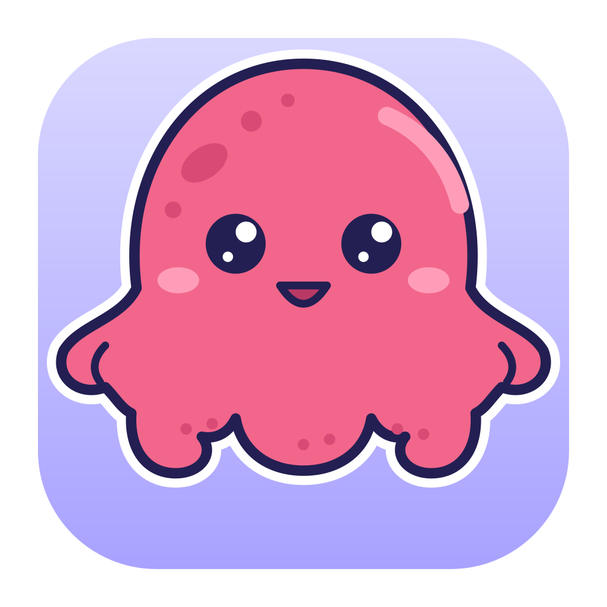
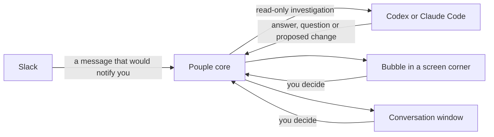

<p align="center">
  
</p>

<h1 align="center">Pouple</h1>

<p align="center">
  Eight arms. Your Slack requests, handled.<br>
  A macOS assistant that has your local Codex or Claude Code look into the messages that would notify you.
</p>

Pouple watches the Slack messages that would notify you (mentions, direct messages, notes to yourself, group chats,
the threads you take part in, and the words you chose to watch). For each one, it asks the AI on your Mac to
investigate your projects, then shows what it found as a floating bubble in a corner of your screen and as a conversation
in a window.

You only take the decisions. Nothing is changed in your code before you approve it, Pouple never posts in Slack for you,
and a Stop button ends any run.

## How it works



- **Bubbles** appear when something needs you. While Pouple first looks into a message, nothing shows but a dot
  blinking on the menu bar icon. Then a question to answer or a change to approve stays until you handle it, and
  **Ignore** drops the request in one click. Once you answered, the bubble stays and shows the work, with a Stop
  button. A ready answer stays until you press **Done**; a change made is confirmed for a few seconds. A failure stays
  too. At most five bubbles are shown, and only one is open at a time; the others are a single line.
- **Questions** may let you pick several options together, for example several actions to take.
- **The mascot** sits on the open bubble and changes pose with what it asks of you: looking for a decision,
  celebrating for a ready answer or an applied change, worried for a failure. It is also the grip to drag the
  panel: on release it snaps to the nearest corner of the screen.
- **The window** holds every conversation, with the whole investigation, the questions and the follow-ups. Open it from
  the menu bar icon or from **Open Pouple** in a bubble.
- **The menu bar icon** opens the window, hides the bubbles, resets their position, starts Pouple at login and switches
  the language (French or English).

## Install

Pouple builds locally on macOS 14 or later, on Intel and Apple Silicon. There is no signed download yet: building on your
own Mac avoids the macOS security warning and guarantees that the app matches the published code.

You need:

| Tool | Version | How |
|---|---|---|
| Xcode Command Line Tools | any | `xcode-select --install` |
| Go | 1.27.3 or later | `brew install go` |
| Node.js | 22.12 or later (24 recommended) | with [nvm](https://github.com/nvm-sh/nvm), below |
| pnpm | 10 | `npm install --global pnpm@10` |

**Node.js with nvm (recommended).** The repository pins Node 24 in `.nvmrc`. nvm installs it in your home folder, and
you can switch versions without touching your system.

```sh
curl -o- https://raw.githubusercontent.com/nvm-sh/nvm/v0.40.3/install.sh | bash
# close and reopen Terminal so nvm loads, then:
nvm install 24
npm install --global pnpm@10
```

Then build and install Pouple:

```sh
git clone https://github.com/Arthur-MONNET/pouple-app.git
cd pouple-app
bash scripts/install-local.sh
```

If Node is not found in a new Terminal, run `nvm use` from the checkout: it reads `.nvmrc`. pnpm is installed per Node
version, so run `npm install --global pnpm@10` again after switching versions.

The script builds and verifies the app, installs it at `~/Applications/Pouple.app`, and launches it. It preserves your
application data and the macOS security settings, and records where the checkout is so that the app can
[update itself](#updates). The same instructions, step by step, are on the
[installation page](https://arthur-monnet.github.io/pouple-app/#install).

## First launch

The first launch guides you through the connections. Each step ends with a card showing whose account you connected, so
you can check it is the right one before anything is saved.

1. **Slack**: one click creates the Slack app with every permission already filled in. Paste the token it gives you.
   Depending on your workspace, an administrator may need to approve the app.
2. **An AI, Codex or Claude** (one is enough, both can be connected):
   - **Codex**: if the CLI is missing, Pouple downloads a verified OpenAI release into its own application folder.
     Sign in with ChatGPT in the browser. A CLI already on your `PATH` is supported too.
   - **Claude**: if Claude Code is missing, Pouple runs Anthropic's official installer. Sign in with your Claude
     subscription in the browser. Pouple has its own login and never reads or changes your usual `~/.claude`.
3. **Projects** (optional): the folder that holds one folder per project. The AI reads them read-only.

The AI and its model can be changed at any time in the settings, with no restart: the next turn uses the new choice.
A usage limit or a sign-in problem pauses only the AI that reported it, and the daily limit counts the turns of both.
When one AI reaches its limit and the other is connected, the failed request offers to continue with the other one.
The window and the menu bar menu show the tokens of the day and how much of each AI's current five-hour window and week
is used; each conversation shows the tokens it took.

### Live updates from Slack

Slack can wake Pouple as soon as an event arrives. In the Slack step, add the optional app-level token (`xapp-`) with
`connections:write`. The generated manifest enables Socket Mode and subscribes to the user message events. For an existing
Slack app, follow the Socket Mode instructions in Pouple's Slack step and save the connection again. Pouple still checks
Slack periodically to catch the messages missed while disconnected.

### More connectors

GitLab, Asana and Slite are optional and read-only, and can be added from the Connectors page at any time. Once connected,
the assistant is given your open tasks and merge requests and the notes that match each Slack message, as data it can
read but never obey. Their tokens live in the Keychain like the Slack token. GitLab can also turn the end of your
pipelines into conversations.

## Local API

Local tools can read and interact with Pouple conversations through the [local Assistant API](docs/LOCAL-API.md).

## Updates

Pouple tells you when a newer version is available: the core checks the public repository 30 seconds after it starts
and every 6 hours (**Pouple → Check for Updates…** looks right away), and the update button shows what changed. Press it,
and Pouple:

1. quits;
2. opens Terminal, goes to the source folder you installed from, and runs `git pull --ff-only`;
3. re-runs `scripts/install-local.sh`, which rebuilds the app, replaces `~/Applications/Pouple.app`, and opens it.

Your connections and settings are kept. The Slack, AI and connector tokens stay in the macOS Keychain, and settings,
conversations and attachments stay in `~/Library/Application Support/Pouple`. The installer only replaces the app bundle
(and keeps the previous one as `.pouple-previous.app`). It also writes a small `install.json` in that folder, which is how
Pouple finds its source folder.

The button needs Pouple to have been installed with `scripts/install-local.sh` from a clone of this repository, still in
place, on `main`, with no local changes and no commits that are not on `origin/main`. Otherwise Pouple says what is wrong
instead of updating. Installations made before this feature have no `install.json` yet: update them once by hand.

To update by hand, quit Pouple, then:

```sh
cd pouple-app && git pull --ff-only && bash scripts/install-local.sh
```

## Security

- Slack tokens live in the macOS Keychain and are write-only in the interface. Codex stores its login in Pouple's
  dedicated Codex home, Claude Code in Pouple's dedicated configuration folder.
- The core listens on `127.0.0.1` only, behind a per-launch bearer token, a Host check and a cross-site check. The macOS
  shell passes the token to the core through its startup pipe and injects it into the web view only for the core's exact
  origin.
- Slack text is always handed to the AI as data between delimiters. The AI works read-only until you approve a change, and
  the writing turn never sees the Slack text.
- Codex runs in its operating-system sandbox. Claude Code has none, so a Claude turn only gets the tools Read, Glob and
  Grep (plus Edit and Write inside the project once you approved), never a shell, the web or an MCP server, and none of
  your settings, hooks or plugins are loaded. See [docs/ARCHITECTURE.md](docs/ARCHITECTURE.md).

## Repository layout

| Folder | What |
|---|---|
| `core/` | Go: connectors, Slack inbox, Codex and Claude runners, assistant engine, local API. One static binary. |
| `web/` | Vue 3 + Tailwind: setup wizard, conversations, connectors, settings. Embedded in the core. |
| `app/` | Swift: the macOS shell (window, menu bar, floating bubbles). |
| `brand/` | The mascot, the app icon and `tokens.json`, the single source of truth for the colors. |
| `site/` | The installation page (GitHub Pages). |
| `scripts/` | Local installation and app bundling. |
| `docs/` | [Architecture](docs/ARCHITECTURE.md) and [local API](docs/LOCAL-API.md). |

## Develop

Use the same tools as for the installation (Node 24 through `nvm use`).

```sh
cd core && go test -race ./...
cd web && pnpm install && pnpm test && pnpm build:embed
cd app && swift test
cd core && go build -o /tmp/pouple-core ./cmd/pouple-core
scripts/build-app.sh --core /tmp/pouple-core    # build/Pouple.app
bash scripts/test-install-record.sh             # dry run of the install record (no build)
```

Run the core alone with a fixed port and token for web development:

```sh
POUPLE_PORT=4400 POUPLE_TOKEN=dev POUPLE_HOME=$(mktemp -d) go run ./cmd/pouple-core
```

Check the look of the bubbles without a core or a screen: the app draws a snapshot into a PNG.

```sh
cd app && swift run Pouple --render /tmp/bubbles.png --snapshot Fixtures/snapshot.json --expand a --lang en
```

The mascots are bundled from `brand/` by `scripts/build-app.sh`; a plain `swift run` has none, so the bubbles then show
without the mascot.

## Release

Push a version tag such as `v0.1.1` to the public repository. The **Release** workflow publishes its source release, which
the in-app update check uses to announce new versions. GitHub Pages hosts the
[installation page](https://arthur-monnet.github.io/pouple-app/#install).
